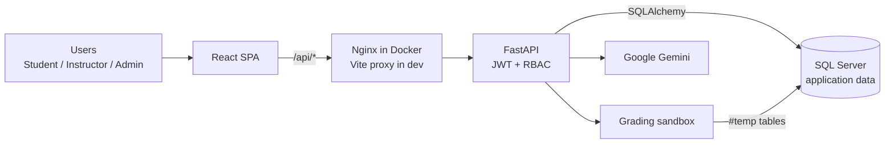
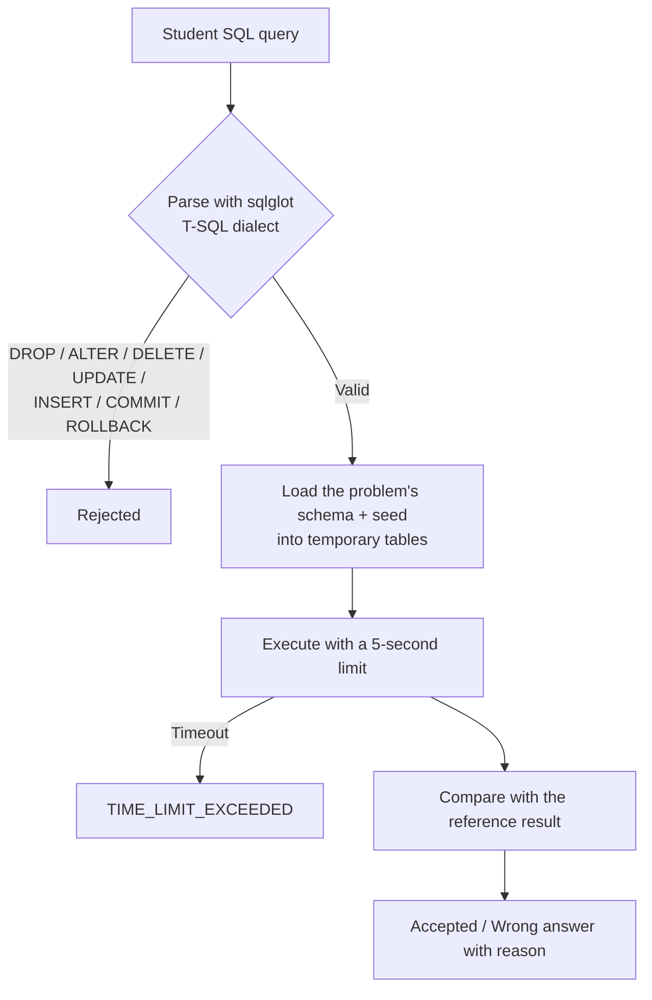

# iSQL

> A web platform for practising SQL with automatic grading, built for UIT students and instructors. A project by Scrum Team **AIgile**.

For UIT students and instructors, iSQL is an educational platform that drives:

- Instant validation of SQL queries
- Hands-on SQL practice directly in the browser
- Efficient assignment management

## 1. Problem and Solution

| Traditional approach | iSQL |
| --- | --- |
| Exercises live in documents; scripts are submitted manually | Solve and submit directly in the browser |
| Students must install SQL Server and SSMS locally | Web-based, no installation required |
| Instructors grade each submission by hand | Automatic grading with instant feedback |
| Exercises, classes and scores are scattered | Centralized classroom management |

## 2. Key Features

The product is organized into four epics:

| Epic | Scope | Roles |
| --- | --- | --- |
| **EPIC-01** Authentication & Role-Based Access Control | JWT login; page and API access allowed or blocked by role (Student / Instructor / Admin) | All |
| **EPIC-02** Course & Question Bank Management | Create classes and enroll students and instructors; upload `.sql` schema scripts and seed data; build a tagged question bank (JOIN, GROUP BY, Subqueries, Window Functions, ...) | Admin, Instructor |
| **EPIC-03** Interactive SQL Execution & Instant Validation | In-browser SQL editor (CodeMirror) with syntax highlighting; queries run on SQL Server and are compared against the reference solution instantly | Student, Instructor |
| **EPIC-04** Assignment Workflow & Automated Grading | Publish assignments with start time, due date and submission limits; automatic grading; gradebook with manual score adjustment; CSV/Excel grade export (planned) | Instructor, Student |

An AI assistant (Google Gemini) is also available to students inside the problem workspace.

## 3. Tech Stack

| Layer | Technology |
| --- | --- |
| Frontend | React 18, TypeScript, Vite, React Router, CodeMirror |
| Backend | Python, FastAPI, SQLAlchemy, Pydantic, PyJWT, sqlglot |
| Database | Microsoft SQL Server (local: SQL Server 2022 in Docker; production: Azure SQL Database) |
| AI | Google Gemini (`google-genai`) |
| DevOps | Docker, Docker Compose, Nginx, GitHub Actions, Microsoft Azure |
| Project management | Notion (backlog, sprints), GitHub |

## 4. System Architecture

### 4.1 Overview



The frontend is a single-page app that calls the backend through the `/api` prefix. In Docker, Nginx serves the static files and forwards `/api` to the backend container; during development the Vite proxy does the same.

### 4.2 Grading Flow (Sandbox)

The logic lives in [`backend/app/services/sandbox.py`](backend/app/services/sandbox.py):



Result comparison rules:

1. The number of columns must match.
2. Column names and column order must match (case-insensitive).
3. The number of rows must match.
4. Row data is compared after sorting, so **row order does not matter**.

### 4.3 Environments

| | Local (Docker Compose) | Production (Azure) |
| --- | --- | --- |
| Frontend | Nginx container, port 8080 | Azure Static Web Apps |
| Backend | FastAPI container, port 8000 | Azure App Service (Linux container), image pulled from Azure Container Registry |
| Database | SQL Server 2022 container + `db-init` job that creates the `SQLUIT` database | Azure SQL Database |

## 5. Project Structure

```text
.
├── backend/              # FastAPI
│   ├── app/
│   │   ├── routers/      # API route groups
│   │   ├── services/     # Grading sandbox
│   │   ├── models.py     # SQLAlchemy models
│   │   ├── schemas.py    # Pydantic schemas
│   │   └── security.py   # JWT, password hashing
│   ├── scripts/          # Database creation, demo data seeding
│   └── tests/
├── frontend/             # React + Vite
│   └── src/
│       ├── pages/        # student/, teacher/, admin/, auth/
│       ├── components/
│       ├── services/     # API calls
│       └── context/      # Auth, Theme
├── docs/                 # Azure CI/CD guide
├── scripts/ci/           # Docker Compose smoke test
├── .github/workflows/    # GitHub Actions
└── compose.yaml          # Full local stack
```

## 6. Quick Start with Docker

You need Docker Desktop (Linux containers, Docker Compose) and enough resources for SQL Server. On ARM machines, the `linux/amd64` SQL Server image may require emulation and its support and performance are not guaranteed; check Microsoft's documentation for your platform. The SQL Server Developer image is for development only, not production.

1. Copy `.env.example` to `.env` and change `MSSQL_SA_PASSWORD` and `SECRET_KEY`. The SQL password must meet SQL Server's complexity rules and contain only letters and digits, because it is embedded in the connection URL. Do not commit `.env`. The Gemini key is optional.
2. From the repository root, run:

   ```bash
   docker compose up --build -d --wait
   ```

   Compose waits for SQL Server to be ready, creates the `SQLUIT` database if it does not exist, then starts the backend and frontend.
3. Open <http://localhost:8080>. The API and Swagger UI are at <http://localhost:8000/docs>. Set `FRONTEND_PORT`, `BACKEND_PORT` or `MSSQL_PORT` in `.env` if the default ports are taken.
4. Optionally, create demo accounts **on a local database only** (the script creates accounts with public passwords; never run it against Azure production):

   ```bash
   docker compose exec backend python -m scripts.seed
   ```

   For the complete UI fixture (all three roles, classes, assignments and contests in every state, submissions, notifications, favorites, a draft and AI chat history), run the idempotent development seed instead. It runs the small demo seed first and requires an explicit local-only opt-in when using the Docker SQL Server container:

   ```bash
   docker compose exec -e ALLOW_DEV_SEED=1 backend python -m scripts.seed_dev_data
   ```

   It is deliberately blocked unless the database is named `SQLUIT` and the target is LocalDB or the explicit `ALLOW_DEV_SEED=1` flag is present. Do not set that flag for shared or production databases.

   On a database that already exists, run the account-management migrations once before using profile changes or the admin password view. `account_management_v2` prints the email of any older account that received a new generated password:

   ```bash
   docker compose exec backend python -m migrations.account_management_v1
   docker compose exec backend python -m migrations.account_management_v2
   ```

Useful commands:

- `docker compose logs -f`: follow the logs.
- `docker compose down`: stop the stack while keeping the database and uploads in named volumes.
- `docker compose down --volumes`: **delete** local data; use only when you really mean it.

If you change the SA password after the database volume has been created, change it inside SQL Server or recreate the local database; editing `.env` does not update existing data.

By default, services only expose ports on localhost. This setup is for development; the Azure environment uses its own resources and secrets, and the local SQL Server container is never deployed to production.

## 7. Running Services Manually

To run the backend and frontend directly on your machine (without Docker):

- Backend: see [backend/README.md](backend/README.md) (Python, ODBC Driver for SQL Server, database creation and seeding, `uvicorn`).
- Frontend: see [frontend/README.md](frontend/README.md) (Node.js 18+, `npm install`, `npm run dev`).

## 8. CI/CD

| Workflow | Trigger | What it does |
| --- | --- | --- |
| `frontend-ci.yml` | Pull requests and pushes (except `production`) | TypeScript checks, service tests, frontend build |
| `backend-ci.yml` | Pull requests and pushes (except `production`) | Unit tests, workflow lint, full stack run with Docker Compose against a real SQL Server |
| `publish.yml` | Push to `production` | Re-runs both CI workflows, pushes the tested backend image to Azure Container Registry |
| `deploy.yml` | Called by `publish.yml` | Deploys the backend to App Service and the frontend to Static Web Apps |

Publishing and deployment are disabled until `ENABLE_AZURE_DEPLOYMENT` is turned on. GitHub Actions authenticates to Azure via OIDC. See [docs/azure-ci-cd.md](docs/azure-ci-cd.md) for the full setup.

