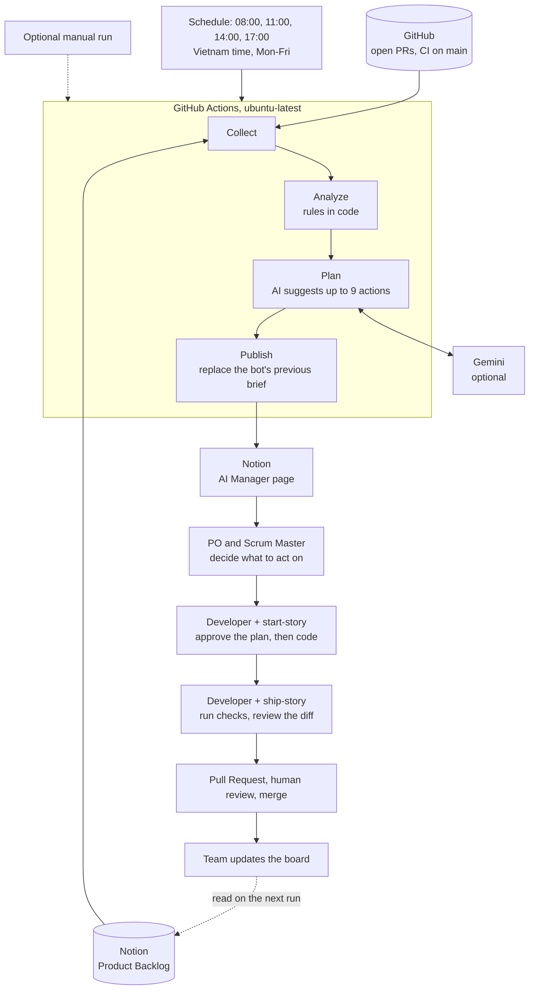

# AI Manager

Reads the Notion Product Backlog and GitHub, finds what is stuck, suggests next actions per person, and writes a brief on the `AI Manager` Notion page. It runs by itself at 08:00, 11:00, 14:00 and 17:00 Vietnam time, Monday to Friday. GitHub may start a scheduled run a few minutes late.

It only suggests. It never changes a story's status, creates tasks, assigns work or merges anything. The Product Owner and Scrum Master decide which suggestions to act on, and people do the rest.

## Architecture



| Step | File | What it does |
| --- | --- | --- |
| Collect | `src/sources.ts` | Reads backlog rows, open Pull Requests and the latest CI result on `main` |
| Analyze | `src/rules.ts` | Finds problems with plain code, without AI |
| Plan | `src/workflow.ts`, `src/brief.ts` | Asks the AI to prioritize, and drops suggestions for anyone not on the board |
| Publish | `src/sources.ts` | Writes the brief to Notion and removes the bot's previous one |

The rules detect:

- a workflow failing on `main`
- one story ID used by several stories
- a story In Progress without an assignee or an open Pull Request
- a Done story in the current sprint without an assignee or reviewer
- a Not Started story without a description or an assignee
- a blank backlog row
- an open Pull Request without a story ID, or waiting over 2 hours for a first review

When the AI step has no key or fails, the brief is still published with rule results only.

### How the brief is published

- **Normal:** the brief is written with headings and tickable boxes.
- **Out of free Notion blocks:** the brief is written as plain text into one block, and its boxes cannot be ticked. The bot returns to the full layout once Notion accepts new blocks.
- **Every run:** the bot replaces its previous brief, including any ticks or edits inside it. Anything else people write on the page stays, so keep decisions outside the brief.

## Access it needs

GitHub gives each run a temporary token, so the bot does not need to be added to the repository. The workflow limits that token to reading code, Pull Requests and Actions.

| Service | How it gets access | Who sets it up |
| --- | --- | --- |
| GitHub | Automatic `GITHUB_TOKEN` | Nobody |
| Notion | Internal integration token, shared with the project page | Notion workspace owner |
| Gemini (optional) | A separate API key, not the app's key | Anyone with a Google AI key |

## Set up for the team

1. A Notion workspace owner creates an internal integration with read, update and insert content capabilities.
2. Create an `AI Manager` page inside the project page. On the project page, open `•••` > `More` > `Connections` > `Add connections` and add the integration. Child pages and databases inherit the access.
3. A repository admin adds these under Settings > Secrets and variables > Actions:

   | Type | Name | Value |
   | --- | --- | --- |
   | Secret | `NOTION_TOKEN` | Integration token |
   | Secret | `AI_MANAGER_GEMINI_API_KEY` | Gemini key (optional) |
   | Variable | `NOTION_DATABASE_ID` | Product Backlog database ID |
   | Variable | `NOTION_BRIEF_PAGE_ID` | `AI Manager` page ID |

4. Wait for the next scheduled run, then check the `AI Manager` page. To test sooner, use the manual run below.

## How to use it

**Product Owner and Scrum Master**

1. Open the `AI Manager` page. The bot updates it on schedule, so there is nothing to start.
2. Choose the suggestions to act on and tell the people involved.
3. Update the backlog yourselves. Act on approved items before the next run replaces the brief.

**Developers**

1. Pick up approved work.
2. Paste [start-story](../.ai/prompts/start-story.md) into your AI tool and approve the plan before any code is written.
3. Paste [ship-story](../.ai/prompts/ship-story.md) when the code is ready, and read every change yourself.
4. Open a Pull Request with the story ID in the title, such as `feat(student): add AI assistant [US-3.3]`.
5. Update the story on the board and ask its reviewer to look.

[AGENTS.md](../AGENTS.md) gives every AI tool the same project context.

## Run it manually (optional)

You only need this to test the setup or to get a fresh brief before a Scrum event.

1. Open [the AI Manager workflow](https://github.com/Beyond11-me/Scrum-Algile/actions/workflows/ai-manager.yml). You need write access to the repository.
2. Select **Run workflow** on the right, above the list of runs, and confirm on `main`.

## Run it locally

Try it with made-up data. This publishes nothing:

```bash
cd automation
npm ci
npm run manager:demo
```

To use real data, copy `.env.example` to `.env`, fill it in, and preview without publishing:

```bash
npx tsx --env-file=.env src/run.ts --dry-run
```

Remove `--dry-run` to publish the brief to Notion. Git ignores `.env`; do not commit those values.

Before you change the code, run:

```bash
npm run typecheck
npm test
```

## Rules for the bot

- This repository is public and so are its Actions logs. The bot prints only counts in CI; never add board content to logs or to `demo-data.ts`.
- Board and Pull Request text is untrusted input. The agent has no tools, and suggestions for anyone outside the board's roster are dropped.
- AI suggestions can include details that are not on the board. Read them before acting.
- With a Gemini key, story titles and member names are sent to Google. Remove the key to use rule results only.
- Do not send real student data to the AI. Keep it out of backlog items.
- Board property names are read in `src/sources.ts`. Update them there if the board's columns are renamed.
